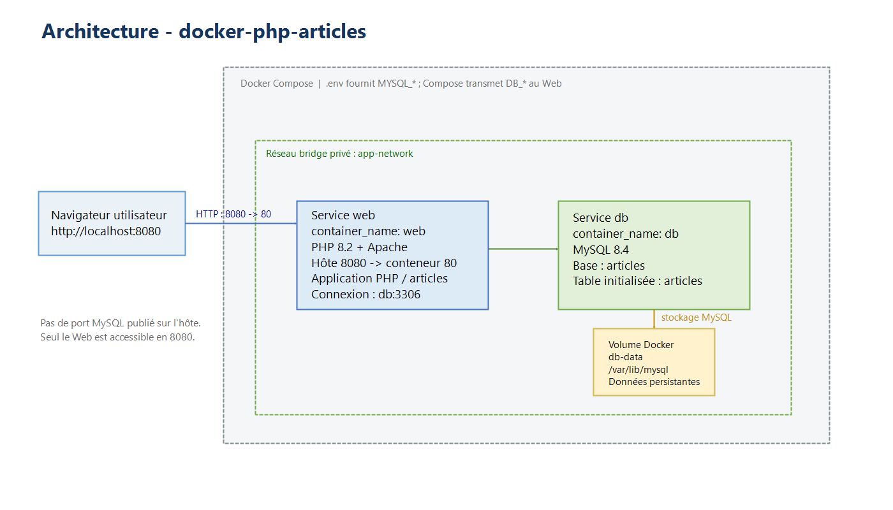

# docker-php-articles

[](https://github.com/Mieru-yo/docker-php-articles/actions/workflows/docker.yml)

Conteneurisation d'une application Web PHP / MySQL (liste d'articles) avec Docker et Docker Compose.

Projet M2 YNOV « Conteneurisation Docker », réalisé par **Jérémy CHAN FUNG TING** et **Yann DUCLOS**.

## Architecture



| Service | Image | Rôle | Port publié |
|---|---|---|---|
| `web` | [`nellotsuka/docker-php-articles-web`](https://hub.docker.com/r/nellotsuka/docker-php-articles-web) | PHP 8.2 + Apache, non-root | `8080` → `80` |
| `db` | [`nellotsuka/docker-php-articles-db`](https://hub.docker.com/r/nellotsuka/docker-php-articles-db) | MySQL 8.4, table `articles` créée au premier démarrage | aucun |

- Les deux services sont sur le réseau bridge `app-network`. Le Web joint la base par son nom : `db:3306`.
- Les données MySQL sont stockées dans le volume nommé `db-data` et survivent à `docker compose down`.
- `web` attend que `db` soit `healthy` avant de démarrer.

Le détail des choix techniques est dans le [rapport](docs/rapport/).

## Prérequis

- Docker Engine avec Docker Compose V2 (`docker compose version`).
- Git.
- Le port `8080` libre sur la machine.

## Déploiement

```bash
git clone https://github.com/Mieru-yo/docker-php-articles.git
cd docker-php-articles
cp .env.example .env          # PowerShell : Copy-Item .env.example .env
# Modifier les deux mots de passe dans .env
```

**Avec les images publiées sur Docker Hub** (aucun build) :

```bash
docker compose pull
docker compose up -d --no-build
```

**En reconstruisant les images à partir des sources** :

```bash
docker compose up -d --build
```

L'application est disponible sur <http://localhost:8080/>.

Arrêt : `docker compose down` (garde les données) ou `docker compose down -v` (supprime aussi le volume `db-data`).

## Variables d'environnement

Fichier `.env`, créé à partir de [.env.example](.env.example) et ignoré par Git :

| Variable | Exemple | Utilisation |
|---|---|---|
| `MYSQL_ROOT_PASSWORD` | à changer | mot de passe `root` de MySQL |
| `MYSQL_DATABASE` | `articles` | base créée au premier démarrage |
| `MYSQL_USER` | `app` | utilisateur de l'application |
| `MYSQL_PASSWORD` | à changer | mot de passe de `MYSQL_USER` |

Compose transmet au service Web `DB_HOST=db`, `DB_PORT=3306`, `DB_NAME`, `DB_USER` et `DB_PASSWORD` (à partir des `MYSQL_*`). Si une variable manque, `docker compose` refuse de démarrer.

## Procédure de test

```bash
# 1. Les deux conteneurs doivent être (healthy)
docker compose ps

# 2. La page d'accueil répond
curl -s -o /dev/null -w "%{http_code}\n" http://localhost:8080/          # 200

# 3. Ajout d'un article, puis lecture depuis la base
curl -s -o /dev/null -w "%{http_code}\n" -X POST http://localhost:8080/validation.php \
  -d "title=Test&author=Moi&content=Bonjour"                              # 302
curl -s http://localhost:8080/ | grep "Test"

# 4. Persistance : l'article est toujours là après un redémarrage
docker compose down && docker compose up -d --no-build
curl -s http://localhost:8080/ | grep "Test"

# 5. Le Web tourne en non-root, la base n'est pas exposée
docker exec web id                                                        # uid=33(www-data)
docker exec web getent hosts db                                           # résolution DNS interne
```

Les mêmes vérifications sont faites automatiquement par la CI à chaque push.

## CI/CD

Le pipeline [.github/workflows/docker.yml](.github/workflows/docker.yml) enchaîne trois jobs :

1. **Lint PHP** : `php -l` sur `app/`.
2. **Build et test** : construction des images, `docker compose up --wait`, ajout et lecture d'un article, vérification non-root.
3. **Publication** (sur `main` uniquement) : push des images sur Docker Hub avec les tags `latest` et le SHA court du commit.

## Structure du dépôt

```
app/                  Code source PHP de l'application
db/init/              Script SQL de création de la table
docker/web/           Dockerfile et configuration Apache / PHP du service Web
docker/db/            Dockerfile du service MySQL
docker-compose.yml    Orchestration des deux services
.env.example          Modèle du fichier de variables
.github/workflows/    Pipeline CI/CD
docs/                 Architecture, organisation du travail et rapport
```
