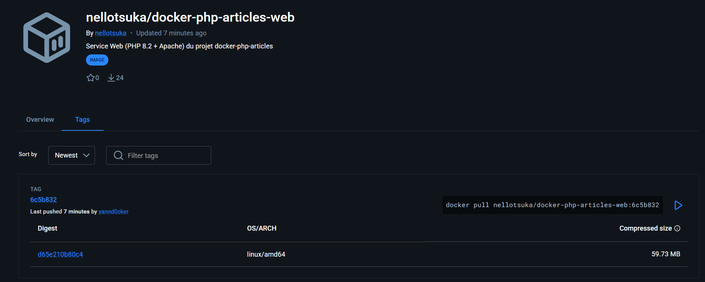
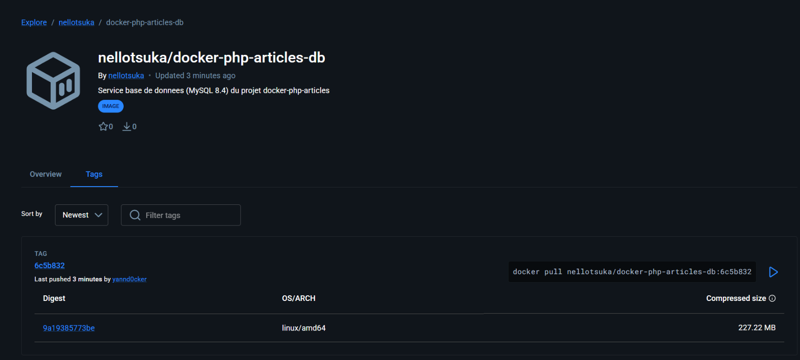

# 7b. Publication sur Docker Hub

Les deux images sont publiées à la main sur Docker Hub, dans les dépôts publics du compte `nellotsuka`, avec le compte `yannd0cker` (collaborateur des dépôts) :

| Image | Dépôt Docker Hub |
|---|---|
| Web (PHP 8.2 + Apache) | `nellotsuka/docker-php-articles-web` |
| Base (MySQL 8.4) | `nellotsuka/docker-php-articles-db` |

## Procédure

Les images portent déjà leur nom complet grâce à la clé `image:` du `docker-compose.yml`. Elles sont construites par Compose, puis chacune reçoit un second tag : le SHA court du commit publié.

```bash
docker login
docker compose build
SHA=$(git rev-parse --short HEAD)
docker tag nellotsuka/docker-php-articles-web:latest nellotsuka/docker-php-articles-web:$SHA
docker tag nellotsuka/docker-php-articles-db:latest  nellotsuka/docker-php-articles-db:$SHA
docker push nellotsuka/docker-php-articles-web:latest
docker push nellotsuka/docker-php-articles-web:$SHA
docker push nellotsuka/docker-php-articles-db:latest
docker push nellotsuka/docker-php-articles-db:$SHA
```

Deux tags par image :

- `latest` : la dernière version, celle qu'utilise `docker compose pull`.
- le SHA court du commit (ici `6c5b832`) : une version précise et reproductible, qui permet de retrouver le code source exact.

`docker login` demande les identifiants dans le terminal ; aucun mot de passe ni jeton n'est écrit dans le dépôt.

## Vérification

Contenu des dépôts, relevé par l'API publique de Docker Hub (sans authentification) :

```
$ curl -s "https://hub.docker.com/v2/repositories/nellotsuka/docker-php-articles-web/tags"
latest   2026-10-29T13:05:03Z   59,7 MB   yannd0cker
6c5b832  2026-10-29T13:05:19Z   59,7 MB   yannd0cker

$ curl -s "https://hub.docker.com/v2/repositories/nellotsuka/docker-php-articles-db/tags"
latest   2026-10-29T13:07:46Z   227,2 MB  yannd0cker
6c5b832  2026-10-29T13:08:00Z   227,2 MB  yannd0cker
```

Les tailles sont celles des images compressées sur Docker Hub. En local, `docker images` affiche les tailles décompressées (276 Mo pour `web`, 1,1 Go pour `db`).

Le tag `latest` et le tag `6c5b832` ont la même taille : ils désignent la même image. Les dépôts sont publics, donc consultables et téléchargeables sans compte.

## Captures

Onglet *Tags* des deux dépôts publics, avec le tag `6c5b832` publié par `yannd0cker`, la plateforme `linux/amd64` et la taille compressée :





Les tailles compressées (59,73 Mo et 227,22 Mo) correspondent à celles relevées par l'API ci-dessus.
