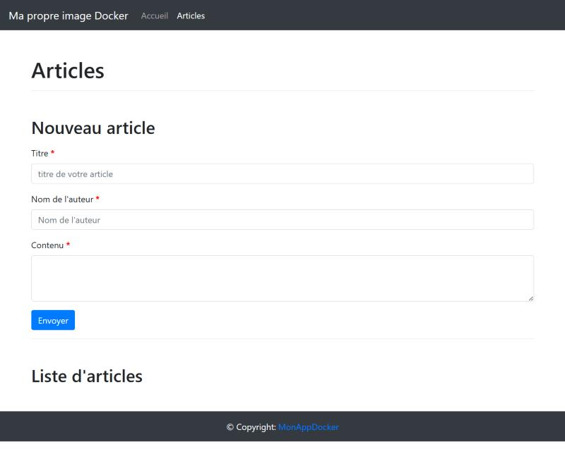
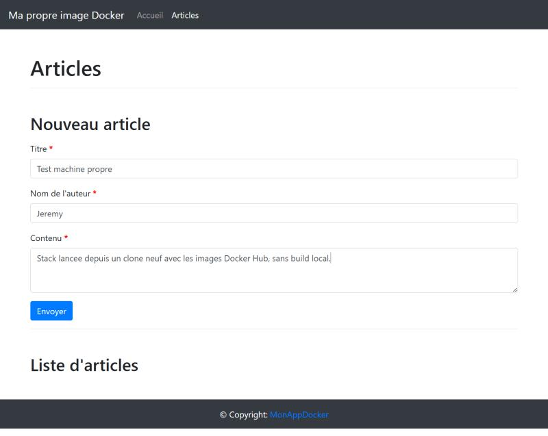
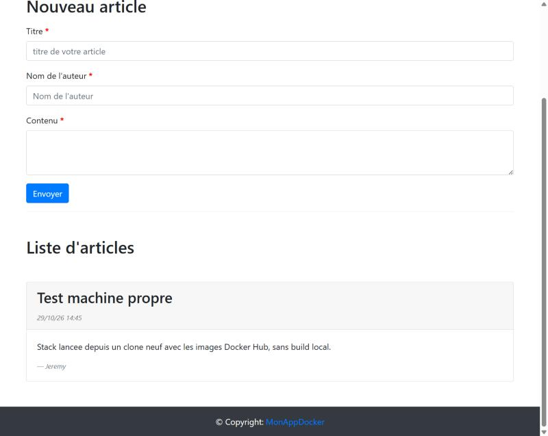

# 8. Déploiement depuis un clone neuf

Objectif : prouver que la stack démarre avec seulement Docker, Git et le dépôt, en utilisant les images publiées sur Docker Hub (aucun build local, aucun `docker login`).

## Environnement

```
> OS
Microsoft Windows 11 Famille 10.0.26200 (build 26200)
> docker version
Client: 29.0.1  Server: 29.0.1 (linux/amd64)
> docker compose version
Docker Compose version v2.40.3-desktop.1
```

Préparation de la machine avant le test :

- les images `nellotsuka/docker-php-articles-web:latest` et `-db:latest` présentes en local ont été supprimées (`docker rmi`), pour que le `pull` les télécharge réellement ;
- aucun conteneur `web`/`db`, volume `db-data` ou réseau `app-network` n'existait ;
- le port `8080` était utilisé par le conteneur d'un autre projet, arrêté pendant le test.

## Clonage et configuration

Dans un dossier vide :

```
PS ...\scratchpad\test-machine-propre> git clone https://github.com/Mieru-yo/docker-php-articles.git
Cloning into 'docker-php-articles'...
PS ...\test-machine-propre\docker-php-articles> git log --oneline -1
96078d3 Merge pull request #13 from Mieru-yo/docs/ci-publish
PS ...\test-machine-propre\docker-php-articles> Copy-Item .env.example .env
```

Les deux mots de passe d'exemple du `.env` ont été remplacés par des valeurs aléatoires de 24 caractères (masquées ci-dessous) :

```
MYSQL_ROOT_PASSWORD=********
MYSQL_DATABASE=articles
MYSQL_USER=app
MYSQL_PASSWORD=********
```

## Démarrage depuis Docker Hub

```
> docker images nellotsuka/docker-php-articles-*
IMAGE   ID             DISK USAGE   CONTENT SIZE   EXTRA

> docker compose pull
 web Pulling
 db Pulling
 e15d78f48822 Downloading [>                                                  ]    684kB/62.63MB
 ...
 db Pulled
 e15d78f48822 Download complete
 e15d78f48822 Pull complete
 web Pulled

> docker compose up -d --no-build
 Network app-network  Created
 Volume db-data  Created
 Container db  Created
 Container web  Created
 Container db  Started
 Container db  Healthy
 Container web  Started

> docker compose ps
NAME   IMAGE                                       STATUS                    PORTS
db     nellotsuka/docker-php-articles-db:latest    Up 47 seconds (healthy)   3306/tcp, 33060/tcp
web    nellotsuka/docker-php-articles-web:latest   Up 25 seconds (healthy)   0.0.0.0:8080->80/tcp, [::]:8080->80/tcp
```

- L'image `web` (couche unique de 62,6 Mo, partie 6) est entièrement téléchargée.
- Pour `db`, seule la dernière couche (le script SQL) est téléchargée : les couches de `mysql:8.4` étaient déjà présentes sur la machine, utilisée pour les TP.
- `--no-build` garantit que Compose utilise les images de Docker Hub et ne reconstruit rien, même si le `docker-compose.yml` contient une section `build`.

## Utilisation de l'application

Captures du navigateur sur `http://localhost:8080/` :

| | |
|---|---|
|  |  |
| Page Articles, liste vide | Formulaire rempli |
|  |  |
| Article enregistré et affiché | Même page après `down` puis `up -d` |

## Persistance

```
> docker compose down
 Container web  Removed
 Container db  Removed
 Network app-network  Removed

> docker volume ls --filter name=db-data
DRIVER    VOLUME NAME
local     db-data

> docker compose up -d --no-build
 Network app-network  Created
 Container db  Created
 Container web  Created
 Container db  Healthy
 Container web  Started

> docker compose ps
NAME   IMAGE                                       STATUS                    PORTS
db     nellotsuka/docker-php-articles-db:latest    Up 27 seconds (healthy)   3306/tcp, 33060/tcp
web    nellotsuka/docker-php-articles-web:latest   Up 21 seconds (healthy)   0.0.0.0:8080->80/tcp, [::]:8080->80/tcp

> curl.exe -s http://localhost:8080/ | Select-String 'Test machine propre'
<h2 class="h3">Test machine propre <small class="text-muted font-italic"></h2>
```

`docker compose down` supprime les conteneurs et le réseau, mais pas le volume `db-data` : l'article créé avant l'arrêt est toujours affiché après le redémarrage.

Nettoyage final : `docker compose down -v`, qui supprime aussi le volume.

## Erreurs rencontrées

Aucune.
